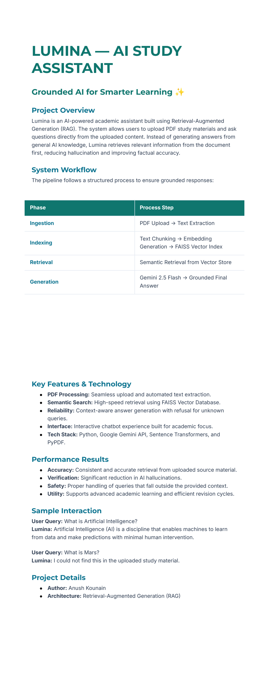
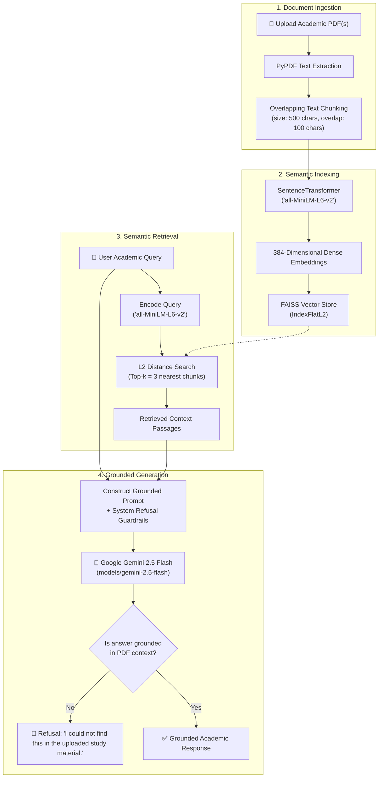

# 📚 Lumina — AI Study Assistant

> **A PDF-based AI study assistant built with Retrieval-Augmented Generation (RAG), Sentence Transformers, FAISS, and Google Gemini 2.5 Flash.**

[](https://www.python.org/)
[](https://ai.google.dev/)
[](https://huggingface.co/sentence-transformers/all-MiniLM-L6-v2)
[](https://github.com/facebookresearch/faiss)
[](LICENSE)
[](https://colab.research.google.com/github/anushkounain/Lumina-RAG-Study-Assistant/blob/main/Lumina_RAG.ipynb)

---

## 📌 Project Overview

**Lumina** is an academic AI assistant that enables students and researchers to upload lecture notes, textbooks, and research papers in PDF format and interact with them through semantic question answering.

Standard Large Language Models often produce ungrounded answers or hallucinations when queried on specific academic materials. Lumina addresses this by employing a **Retrieval-Augmented Generation (RAG)** pipeline:
1. It ingests and parses the user's uploaded PDF.
2. It fragments the text into overlapping chunks and projects them into a dense vector space using `all-MiniLM-L6-v2`.
3. It performs sub-millisecond semantic search via Facebook AI Similarity Search (**FAISS**).
4. It supplies the most relevant source passages directly into the prompt context of **Google Gemini 2.5 Flash**.
5. It enforces strict grounding constraints and an explicit **refusal mechanism** if the query cannot be answered from the provided text.

---

## 🖼️ System Infographic & Architecture

<p align="center">
  
</p>

> *The original vector infographic is available in the repository as [`Lumina Project Infographic.pdf`](Lumina%20Project%20Infographic.pdf).*

### Architecture Diagram



---

## 🎯 Problem Statement & Objectives

### Problem
Students dealing with extensive academic materials face two challenges when using generative AI for study:
- **Hallucinations & Speculation:** Standard LLMs lack access to private course handouts and often fabricate facts or equations.
- **Context Loss:** Feeding entire textbooks directly into an LLM context window is computationally wasteful and prone to "lost-in-the-middle" attention degradation.

### Objectives
- **Strict Grounding:** Ensure answers are derived strictly from the retrieved document chunks.
- **Fast Similarity Search:** Enable sub-second semantic retrieval using FAISS vector indexing.
- **Refusal Guarantee:** Reject out-of-scope or unverified queries instead of attempting to guess.
- **Accessible Deployment:** Provide an end-to-end reproducible workflow executable directly in Google Colab with zero infrastructure overhead.

---

## ⚙️ Key Features

- **Automated Multi-Page PDF Ingestion:** Extracts clean text across single or multi-file study materials using `pypdf`.
- **Sliding Window Chunking:** Partitions source text with a chunk size of 500 characters and an overlap of 100 characters to prevent loss of context across chunk boundaries.
- **Dense Semantic Embeddings:** Encodes text using the lightweight, high-performance `all-MiniLM-L6-v2` transformer model (384 embedding dimensions).
- **In-Memory FAISS Indexing:** Fast exact L2 similarity search (`faiss.IndexFlatL2`) with local index persistence (`faiss_index.index`).
- **Context-Augmented Gemini Inference:** Formulates grounded prompts dispatched to Google Gemini 2.5 Flash.
- **Out-of-Context Refusal Mechanism:** Guardrail prompt engineering instructs the model to refuse unsupported questions with a deterministic refusal response:
  > *"I could not find this in the uploaded study material."*
- **Interactive Terminal/Colab Chatbot:** Built-in interactive Q&A loop featuring clean output formatting (`textwrap`) and graceful exit handling.

---

## 🧪 Technology Stack

| Component | Technology | Rationale / Specification |
|---|---|---|
| **Language** | Python 3.10+ | Core development language |
| **LLM Reasoning** | Google Gemini 2.5 Flash (`models/gemini-2.5-flash`) | Fast, context-aware generation via `google-generativeai` |
| **Embeddings** | `sentence-transformers/all-MiniLM-L6-v2` | 384-dimensional dense vectors tuned for semantic similarity |
| **Vector Database** | FAISS (`faiss-cpu`) | Exact nearest-neighbor search (`IndexFlatL2`) |
| **Document Parser** | PyPDF (`pypdf`) | Lightweight, dependency-free PDF text extraction |
| **Numerical Processing** | NumPy | Matrix conversion for vector similarity operations |
| **Environment** | Google Colab | Cloud GPU/CPU execution with interactive secret management |

---

## 🔄 Explanation of the RAG Workflow

```text
PDF Upload ➔ Text Extraction ➔ Sliding Window Chunking ➔ Vector Embeddings ➔ FAISS Index ➔ Semantic Search ➔ Grounded Gemini Prompt ➔ Output Answer
```

1. **Extraction:** PyPDF reads each page sequentially, stripping non-printable artifacts and aggregating raw text.
2. **Chunking Strategy:** Fixed-length character slicing (500 chars) with stride (400 chars) produces a 100-character overlap, guaranteeing that sentences spanning boundary edges are never bifurcated without shared context.
3. **Vector Transformation:** Sentence Transformers transforms each chunk into an $L_2$-normalized dense vector in $\mathbb{R}^{384}$.
4. **Vector Indexing:** Vectors are added to an `IndexFlatL2` FAISS index and written to disk as `faiss_index.index`.
5. **Top-K Retrieval:** When a student enters a question, the query vector is searched against the FAISS index to retrieve the $k=3$ most semantically relevant text chunks.
6. **Prompt Augmentation:** The top 3 chunks are concatenated with line breaks into a unified `Context` block, paired with Lumina's system guardrails.
7. **Inference & Safety:** Gemini generates the answer. If the answer does not exist in the context, Lumina issues the standardized refusal statement.

---

## 📊 Example Queries & Observed Behavior

| Query | Context In Uploaded Material? | System Response / Behavior |
|---|:---:|---|
| **"What is Artificial Intelligence?"** | ✅ Yes | Returns a concise, grounded explanation extracted from the uploaded machine learning notes. |
| **"Explain the ReAct Loop in Agent Architecture."** | ✅ Yes | Summarizes the exact reasoning-acting loop defined in the study document. |
| **"What are the foundations of Machine Learning?"** | ✅ Yes | Details Task (T), Performance (P), and Experience (E) from the source material. |
| **"What is Mars?"** | ❌ No | **Refusal:** `"I could not find this in the uploaded study material."` |
| **"Who won the 2024 World Cup?"** | ❌ No | **Refusal:** `"I could not find this in the uploaded study material."` |

---

## 🔐 Secure API Key Configuration

Never hardcode Gemini API keys into your notebook or source code. Lumina handles credentials securely across both Google Colab and local environments:

### In Google Colab (Recommended)
1. Open the notebook in Google Colab.
2. Click the **Secrets (key icon)** in the left sidebar.
3. Click **Add new secret**.
4. Set the name to `GOOGLE_API_KEY` and paste your Gemini API key from [Google AI Studio](https://aistudio.google.com/).
5. Toggle on **Notebook access**.
6. The notebook automatically accesses the key via:
   ```python
   from google.colab import userdata
   GOOGLE_API_KEY = userdata.get('GOOGLE_API_KEY')
   ```

### In Local Environments
Set the environment variable in your terminal before launching:
```bash
# On Windows (PowerShell)
$env:GOOGLE_API_KEY="your-gemini-api-key-here"

# On Linux / macOS
export GOOGLE_API_KEY="your-gemini-api-key-here"
```
If no key is detected, Lumina will prompt for it using `getpass` without echoing the input to the console.

---

## 🚀 Getting Started

### Option A: Run in Google Colab (Fastest)
1. Click the **Open in Colab** badge above or open [`Lumina_RAG.ipynb`](Lumina_RAG.ipynb).
2. Set your `GOOGLE_API_KEY` in Colab Secrets.
3. Run the notebook cells sequentially (**Runtime → Run all** or `Ctrl + F9`).
4. Upload your study PDF when prompted in Section 3.
5. Ask questions in the interactive chatbot cell (type `exit` to finish).

### Option B: Run Locally

```bash
# 1. Clone the repository
git clone https://github.com/anushkounain/Lumina-RAG-Study-Assistant.git
cd Lumina-RAG-Study-Assistant

# 2. Create and activate a virtual environment
python -m venv venv
# Windows:
.\venv\Scripts\activate
# macOS/Linux:
source venv/bin/activate

# 3. Install required dependencies
pip install -r requirements.txt

# 4. Launch Jupyter Notebook or Jupyter Lab
jupyter notebook Lumina_RAG.ipynb
```

---

## ⚠️ Limitations & Hallucination Considerations

- **Hallucination Mitigation vs. Elimination:** While semantic retrieval and strict system instructions drastically reduce unsupported statements compared to raw LLM prompting, retrieval-augmented systems **do not guarantee zero hallucinations**. In rare cases, subtle misinterpretations or edge-case completions may occur.
- **Character-Based Chunking:** The current implementation uses fixed character chunking (500 characters). This can occasionally split sentences across mid-word boundaries compared to token-based or recursive semantic chunking.
- **PDF Formatting Variations:** Scanned PDFs (pure images without OCR layers) and complex multi-column layouts or tables may require additional OCR preprocessing (e.g., Tesseract or LayoutLM).
- **Session-Based Storage:** In Google Colab, uploaded files and the FAISS index persist only for the duration of the Colab runtime session.

---

## 🔮 Future Improvements

- [ ] **Recursive & Semantic Chunking:** Implement sentence-aware and paragraph-aware splitting (e.g., LangChain or LlamaIndex semantic splitters).
- [ ] **Dense + Sparse Hybrid Search:** Combine FAISS dense embeddings with BM25 keyword search for enhanced terminology matching.
- [ ] **Persistent Web Interface:** Build a lightweight Streamlit or Gradio user interface for drag-and-drop document uploads.
- [ ] **Citation & Page Attribution:** Return the exact PDF page numbers alongside each generated response for transparent verification.
- [ ] **Support for Scanned PDFs:** Add OCR fallback preprocessing using `pytesseract`.

---

## 👤 Author

**Anush Kounain**  
- GitHub: [@anushkounain](https://github.com/anushkounain)  
- Email: [anushkounain45@gmail.com](mailto:anushkounain45@gmail.com)

Developed as part of the **Prompt Engineering Mastery Assignment (Track B — RAG & Knowledge Systems)**.

---

## 📄 License

This project is licensed under the [MIT License](LICENSE).
